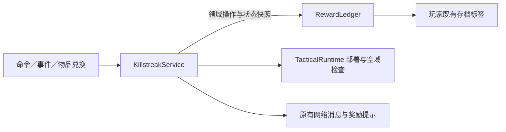

# 模块设计与性能整理

4.32.0 使用 `mattpocock-skills@mattpocock` 的 `codebase-design` 技能指导本轮重构。全工程沿用用户现有的包分类，重点处理奖励账本、模型绘制、HUD 动画和客户端资源生命周期。

## 使用的设计原则

| 技能用语 | 在本项目中的含义 |
| --- | --- |
| Module | 统一负责一个概念及其内部规则的模块，例如奖励账本 |
| Interface | 调用者需要知道的操作、顺序和约束，不限定为 Java 的 `interface` 关键字 |
| Depth | 少量操作所覆盖的完整行为，例如一次扣除同时维护库存和就绪标记 |
| Seam | 行为可被替换的位置；本轮继续使用 Minecraft 存档和 NeoForge 生命周期已有的位置 |
| Adapter | 实际接入某个位置的实现；本轮没有为单一实现增加额外适配层 |
| Locality | 同一规则及其修复集中在一个模块内 |
| Leverage | 多个调用方共享规则和缓存，无需重复实现 |

对新增封装使用 deletion test：删掉它之后，若存档格式、计数规则和缓存失效顺序会重新散到多个调用点，它就隐藏了实际复杂度。单纯转发参数的包装则应合并。

## 奖励账本

`RewardLedger` 在包内提供状态快照、击杀结算、配装选择、获取、扣除、退款和重置操作。计数、容量、就绪标记、自然获取规则和旧存档迁移全部由账本维护。命令入口无需理解标签字符串格式。

- 每次操作只读取一次玩家标签并建立索引，随后按键查询；只把发生变化的标签写回。
- 账本只在当前服务端操作内使用，不跨游戏刻缓存玩家状态，避免重生、切换世界或配置变化后使用旧数据。
- 原有 `killstreakcod.*` 标签格式继续使用。特别注意旧配装键没有 `=`，不可按普通数值键拆分。
- 击杀／得分模式、重复获取／单命限领规则以及 MGB、无畏战甲开关继续由 SERVER 配置决定。
- 禁用奖励的库存和额外奖励队列仍保存在存档中；获取和使用受配置控制。
- 库存增加使用饱和运算，达到 `Integer.MAX_VALUE` 后不溢出为负数；无效配装 ID 回退到对应默认槽位。
- 物品兑换队列满时拒绝消费凭证；命令发放、空投和退款的队列溢出沿用补发奖励卡规则。
- 部署检查通过后才扣库存；部署后重新读取终端状态，以接收可能发生的同步退款。
- `resetall` 同时清理普通实体与兼容载具的待结算击杀，避免刚重置后再次入账。

## 模型绘制

`ImportedCastModel` 的外部绘制入口继续按普通模型、过场、座舱和手臂区分。内部使用 `RenderPass`，替代多层布尔参数的转发重载。

- 可见性相关的索引放在同一个 `Geometry` 中，加载时生成，绘制时复用。
- 手指隐藏、左手筛选、座舱玻璃、损坏玻璃以及源坐标转换仍按各自渲染阶段处理。
- 固定玻璃 RenderType 和材质分类结果预先保存，减少逐帧创建资源位置及判断材质字符串。
- 原资源模型、骨骼、动作、纹理、着色器和可选光影兼容入口继续使用现有数据。

## HUD 动画与图像

`NativeSceneUi.state`、`layers`、`bounds` 和图像访问入口保持原来的调用方式，内部缓存固定的源资源解析结果。

- 源动画通道第一次使用时编译成只读时间线，保存关键帧次序、独立属性分组、时长、目标值和材质／可见性切换。
- 保留源通道及属性的执行顺序、缓动函数和采样计算。每帧不再重新排序关键帧、构造属性分组或编译材质正则表达式。
- 图像元数据和解析后的纹理位置跨帧复用；缺失图像也缓存到下一次资源重载，避免连续访问资源并抛出异常。
- 资源重载时清除时间线和图像缓存，关闭已读取的原图，随后按新资源重新加载。

## 客户端资源生命周期

七处分散的资源重载监听合并到 `ClientResourceReload`。它作为客户端重载的唯一入口，在渲染线程依次处理模型及骨骼缓存、动画、HUD、平板和手机纹理、皮肤、热成像、射弹、特效及相关播放状态。

各模块只负责释放自己持有的数据。模型缓存不再隐式清理载具骨骼，遥控 HUD 不再隐式重载字幕和整个平板界面，源 UI 不再隐式释放过场座舱。依赖顺序直接写在同一重载入口中。

实际的着色器注册、退出世界和玩法会话结束仍遵循对应的 NeoForge 事件。资源重载不会启动或取消服务端奖励。

## 构建与验证范围

生产构建使用 Java 21、Minecraft 1.21.1、NeoForge 21.1.232。网络字段和 `KillstreakcodMod.NETWORK_VERSION = "1.0.0"` 沿用上一版。

本轮进行 Java 编译、逐签名引用分析、资源文件与原包比较、Mixin 目标检查和发行归档核对；未启动 Minecraft，未运行游戏测试或帧率基准。运行时收益来自减少明确的重复工作，实际 FPS 变化需要在游戏中测量。

修改前快照与上版发行包保存在工程外的 `D:\Projects\killstreakcod-archive\20261015-mattpocock-architecture`；当前构建和核对记录保存在 `build/logs`、`build/reports`。
